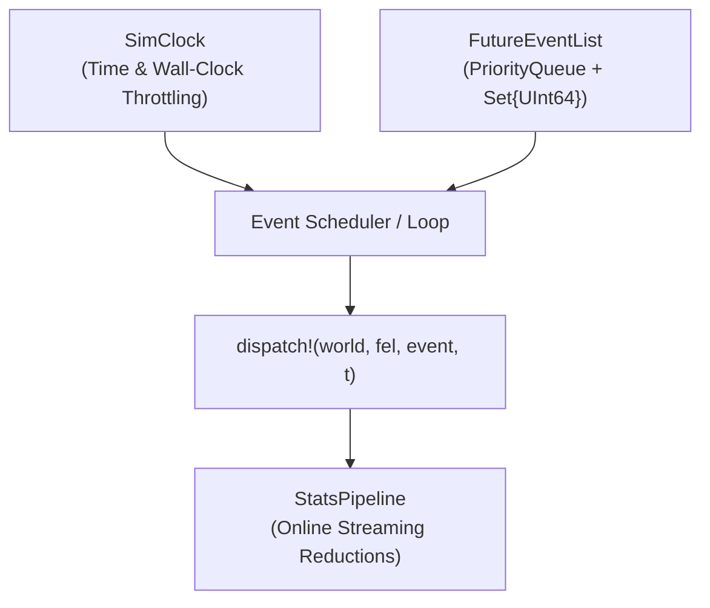

# Architecture & Event Dispatch

## Core Principles

`SimCore.jl` follows three core architectural principles:

1. **No Global Mutable State:** All simulation state is encapsulated within struct instances (`SimWorld`, `StatsPipeline`, `SimClock`).
2. **Type-Stable Dispatch:** Inner event loops and statistical updates are strictly type-stable, avoiding allocations in the simulation hot path.
3. **Downward Dependencies Only:** `SimCore` has zero knowledge of visualizers or high-level DES queuing logic.



---

## Simulation Clock (`SimClock`)

The `SimClock` manages simulated time `t` and wall-clock synchronization.

```julia
clock = SimClock()
set_speed!(clock, 2.0)   # Run at 2x real-time speed
# or set_speed!(clock, Inf) for unthrottled maximum-speed computation
```

### Throttle Behavior
- `speed_factor == Inf`: Updates `sim_time` without sleeping (fastest execution).
- `speed_factor < Inf`: Sleeps the calling thread until real elapsed wall time matches `sim_time / speed_factor`.
- `paused == true`: Blocks execution until `unpause!(clock)` or `step_once!(clock)` is invoked.

---

## Event Scheduling & Cancellation

Every simulation event inherits from the abstract type `SimEvent`.

### Event Types
- `EntityArrival(entity_id, zone_id, time, priority, is_external)`: Entry of an item or customer.
- `ProcessComplete(entity_id, station_id, time)`: Service completion at a server or station.
- `ResourceFailure(resource_id, severity, time)`: Machine breakdown or degradation.
- `ScheduledChange{S}(zone_id, time)`: Pre-scheduled state transition.
- `CustomUserEvent(zone_id, element_id, tag, time, payload, interval, callback)`: Custom user-injected callbacks.

### Lazy Cancellation
Events can be cancelled in $O(1)$ time by passing their unique `UInt64` identifier to `cancel!(id)` (global set) or `cancel!(fel, id)` (FEL-local set). The event remains in the heap but is silently discarded upon dequeue.
